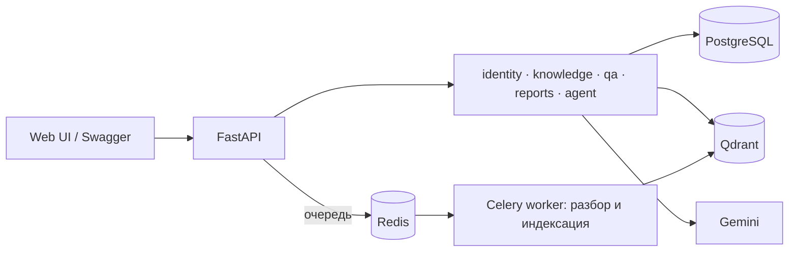

<div align="center">

# Chartroom

**RAG-ассистент по судовым процедурам (SMS/ISM) с проверяемыми цитатами, разбором отчётов и агентом с вызовом функций.**


</div>

Ответы строятся только по загруженным документам и сопровождаются ссылкой на раздел и страницу. Если подходящего источника нет, система отказывает, а не угадывает. Корпус в репозитории синтетический.

## Возможности

- **Вопросы по процедурам** — гибридный поиск (dense + BM25, слияние RRF) в Qdrant, ответ Gemini, каждая цитата сверяется с найденным фрагментом.
- **Версии документов** — отвечает по актуальной версии, индексация идёт в фоне (Celery).
- **Отчёты и чек-листы** — разбор свободного текста в структуру по шаблону (JSON Schema), проверка полей и статусы `draft` → `needs_review` → `accepted`.
- **Агент** — Gemini function calling: поиск по процедурам, список и чтение отчётов, шаблоны. Только чтение, права берутся из токена пользователя.
- **Безопасность** — JWT и роли, rate limit, строгий CSP, защита загрузки файлов, `pip-audit` и `gitleaks` в CI.
- **Eval** — золотые наборы для поиска, ответов и агента: `make eval`, `make eval-agent`.

## Архитектура



Модульный монолит: внутри модуля `domain → ports → service → api/adapters`, границы проверяет import-linter. Подробнее — [docs/architecture.md](docs/architecture.md) и [ADR](docs/adr/).

## Быстрый старт

Нужны Docker и [uv](https://docs.astral.sh/uv/).

```bash
cp .env.example .env                        # впишите GEMINI_API_KEY
make up                                     # интерфейс: http://localhost:8088 · Swagger: /docs
make user EMAIL=admin@ship.test ROLE=admin  # первый пользователь
make seed                                   # демо-корпус и шаблоны отчётов
```

## Разработка

```bash
make lint    # ruff, mypy --strict, import-linter
make test    # unit и интеграционные тесты, покрытие ≥ 95%
make audit   # уязвимости в зависимостях
make eval    # золотой набор вопросов (нужен GEMINI_API_KEY)
make eval-agent
```

## Качество (eval)

`make eval` проверяет поиск и ответы на `eval/golden.yaml` (30 вопросов), `make eval-agent` — выбор инструментов и устойчивость к prompt injection на `eval/agent_golden.yaml` (10 сценариев). Итоговые таблицы записываются сюда автоматически.

<!-- eval:start -->
<!-- eval:end -->

<!-- agent-eval:start -->
<!-- agent-eval:end -->

## Стек

Python 3.12 · FastAPI · Pydantic v2 · SQLAlchemy 2 (async) · Alembic · PostgreSQL 16 · Qdrant · Celery · Redis · Gemini API · Docker Compose · uv · ruff · mypy · pytest

## Документация

[Архитектура](docs/architecture.md) · [ADR](docs/adr/) · [Журнал решений по работе с ИИ](docs/ai-log.md)
