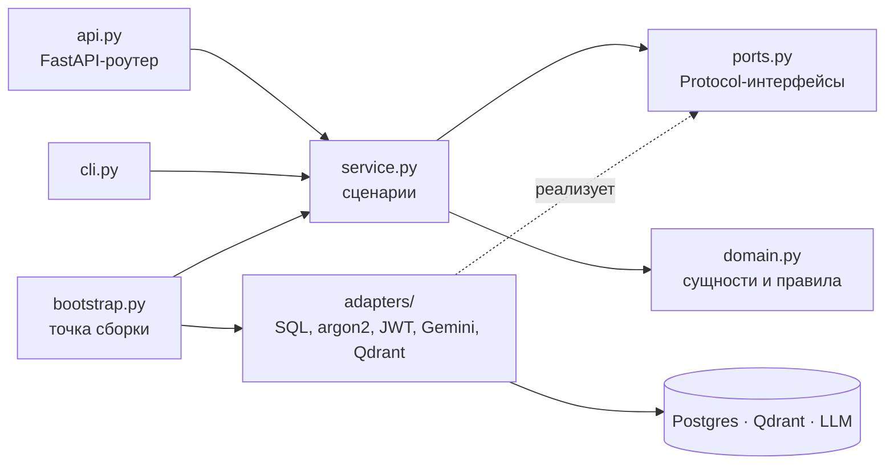

# Архитектура

Модульный монолит: модули по предметным областям, внутри каждого — порты и адаптеры. Обоснование — [ADR-001](adr/001-modular-monolith.md).

## Слои модуля

| Слой | Знает | Не знает |
|---|---|---|
| `domain.py` | только себя и `shared.errors` | фреймворки, БД, I/O |
| `ports.py` | домен | реализации |
| `service.py` | порты, домен | FastAPI, SQLAlchemy, внешние SDK |
| `api.py` | сервис, домен | хранилище и адаптеры |
| `adapters/` | порты, домен, свою библиотеку | HTTP |

Правила закреплены контрактами import-linter (`[tool.importlinter]` в `pyproject.toml`) и проверяются в `make lint` и CI.

## Модули

| Модуль | Отвечает за | Статус |
|---|---|---|
| `identity` | пользователи, роли, вход | готов |
| `knowledge` | документы, версии, разбор, нарезка, индексация, гибридный поиск | готов (ADR-004…006) |
| `qa` | вопросы: поиск фрагментов, отказ, генерация, проверка цитат, журнал, отзывы | готов (ADR-006…008) |
| `evaluation` | золотые наборы, метрики, отчёты | готов: `make eval`, `make eval-agent` (ADR-009) |
| `reports` | шаблоны, извлечение, проверка, статусы отчётов | готов (ADR-011) |
| `agent` | вызов функций (Gemini function calling), только чтение, права пользователя, аудит | готов (ADR-012) |

`shared/` — общее ядро без бизнес-логики: конфиг, базовые ошибки, база ORM и Unit of Work.

Модули связаны только через края: HTTP-слои проверяют права через `identity.api`, а `qa` ищет фрагменты через свой порт и адаптер к `knowledge` (ADR-006). Ядра модулей друг друга не импортируют — это проверяет контракт независимости.

HTTP-край защищён в `main.py`: заголовки безопасности, строгий CSP у страницы, лимиты частоты и метрики (ADR-013). Страница `/` — статические файлы пакета `chartroom/ui`, не модуль предметной области.

Точки сборки две: `main.py` (API) и `worker.py` (Celery-worker индексации). Обе берут зависимости из `bootstrap.py`.

## Ошибки
Домен бросает наследников `DomainError`: `AuthenticationError` → 401, `PermissionDeniedError` → 403, `NotFoundError` → 404, `ConflictError` → 409, `InvalidInputError` → 422. Недоступность внешнего сервиса — `ServiceUnavailableError` → 503 с `Retry-After`, превышение лимита — `TooManyRequestsError` → 429 с `Retry-After`: это не бизнес-ошибка, и её можно повторить. Перевод в HTTP-статусы сделан в одном месте (`main.py`), поэтому новый модуль не трогает обработчики.

## Как добавить модуль
1. `chartroom/<module>/` с `domain.py`, `ports.py`, `service.py`, `api.py`, `adapters/`.
2. Добавить модуль в `containers`, `source_modules` и `modules` (контракт независимости) import-linter.
3. Собрать сервис в `bootstrap.py`, подключить роутер в `main.py`.
4. Тесты: домен и сервис — на фейках; адаптеры — контрактный набор на фейке и реальной инфраструктуре.
