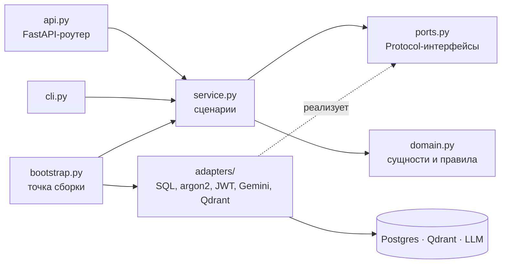

# Архитектура

Модульный монолит: модули по предметным областям, внутри каждого — порты и адаптеры. Обоснование — [ADR-001](adr/001-modular-monolith.md).

## Слои модуля

| Слой | Знает | Не знает |
|---|---|---|
| `domain.py` | только себя и `shared.errors` | фреймворки, БД, I/O |
| `ports.py` | домен | реализации |
| `service.py` | порты, домен | FastAPI, SQLAlchemy, внешние SDK |
| `api.py` | сервис, домен | хранилище и адаптеры |
| `adapters/` | порты, домен, свою библиотеку | HTTP |

Правила закреплены контрактами import-linter (`[tool.importlinter]` в `pyproject.toml`) и проверяются в `make lint` и CI.

## Модули

| Модуль | Отвечает за | ТЗ | Статус |
|---|---|---|---|
| `identity` | пользователи, роли, вход | §2 | готов |
| `knowledge` | документы, версии, разбор, нарезка, индексация | FR-1, 2, 8 | разбор и нарезка готовы; индексация — день 4 |
| `qa` | поиск, отказ, генерация, цитаты, отзывы | FR-3…7 | день 5–7 |
| `evaluation` | золотые наборы, метрики | FR-14, 15, 23 | день 8–9, 13 |
| `reports` | шаблоны, извлечение, проверка отчётов | FR-9…13 | день 10–11 |
| `agent` | вызов функций (Gemini function calling) | FR-16…22 | день 12–13 |

`shared/` — общее ядро без бизнес-логики: конфиг, базовые ошибки, база ORM и Unit of Work.

## Ошибки
Домен бросает наследников `DomainError`: `AuthenticationError`, `PermissionDeniedError`, `ConflictError`, `InvalidInputError`. Перевод в HTTP-статусы сделан в одном месте (`main.py`), поэтому новый модуль не трогает обработчики.

## Как добавить модуль
1. `chartroom/<module>/` с `domain.py`, `ports.py`, `service.py`, `api.py`, `adapters/`.
2. Добавить модуль в `containers`, `source_modules` и `modules` (контракт независимости) import-linter.
3. Собрать сервис в `bootstrap.py`, подключить роутер в `main.py`.
4. Тесты: домен и сервис — на фейках; адаптеры — контрактный набор на фейке и реальной инфраструктуре.
